  

### Обо мне

Python-бэкенд разработчик. Пишу асинхронные сервисы на FastAPI, проектирую схемы в PostgreSQL
и строю надёжную доставку событий через RabbitMQ: outbox, ретраи, DLQ, идемпотентность.

  
  
  
  
  
  
  

### LeetCode

